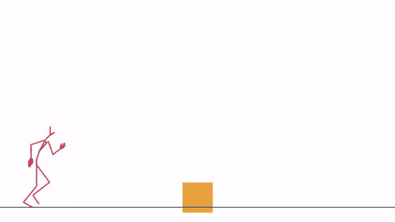
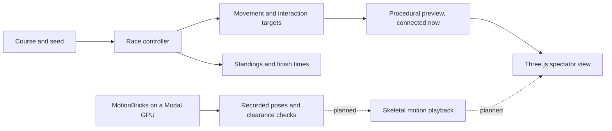

<h1 align="center">MotionGuys</h1>

<p align="center"><b>MotionBricks characters race through an obstacle course.</b><br>
Eight runners, a wall to vault, a ceiling to duck under, and a gap before the finish. You watch the race.</p>

<p align="center">
  
</p>

MotionBricks now generates real run, jump, and duck motion on a Modal GPU. That motion is not in the browser race yet. The browser preview still runs procedural characters, and obstacle physics are not connected.

## How it works

1. **Course.** One shared track with a low wall, a low ceiling, and a gap. The layout lives in `src/game/course.ts`.
2. **Runners.** Eight named characters race automatically. A seed fixes their speeds. The current controller follows straight lanes and selects an action for each obstacle.
3. **Motion.** `scripts/modal_clip.py` drives MotionBricks characters headlessly and saves their skeletal poses. The browser does not play those poses yet, so the current preview uses simple procedural poses instead.
4. **Race.** A fixed-step simulation tracks progress, finish times, and standings. The browser draws the scene separately so the same seed produces the same race order.

## System design

The race chooses where each runner goes. The motion layer supplies how its body moves.



## Results

| Component | Status |
|---|---|
| Eight runners and seeded race order | Implemented |
| Course and procedural action preview | Implemented |
| Pause, restart, orbit camera, standings | Implemented |
| MotionBricks inference on a Modal GPU | Implemented |
| Skeleton playback in the browser | Next |
| Contact checks, falls, recovery, and runner collisions | Planned |
| Saved runs and video export | Planned |

One generated runner per obstacle, from NVIDIA's gym scene, 270 frames each at 30 Hz:

| Obstacle | Primitive | Joints inside the obstacle |
|---|---|---:|
| 0.5 m box | `jump_0_5m` | 0 frames |
| 0.85 m wall | `jump_0_75m` | 2 frames |
| Bar, underside at 1.45 m | `avoidance` | 0 frames |

Time per frame with runners sharing one engine on a Modal L4. A 30 Hz frame allows 33.3 ms.

| Runners | Mean | p95 | Max |
|---:|---:|---:|---:|
| 1 | 1.2 ms | 7.6 ms | 9.5 ms |
| 2 | 2.3 ms | 8.2 ms | 15.5 ms |
| 8 | 9.2 ms | 26.1 ms | 62.1 ms |

These checks test joint positions, not the body mesh, and these obstacles do not move. In the browser preview, characters still follow scripted lanes and clear every obstacle, and seeded speeds determine the winner. The upstream primitives cross a box and a wall, not a gap, so the course's gap is untested.

## The video

The GIF above is the motion check, not the finished video. The intended video follows a pack of MotionBricks characters through the same course, cutting between the leader and the runners trying to catch up.

## Run it

```bash
npm ci                  # Node.js 22.14 or newer
npm run dev             # open the printed local URL
npm run check           # check TypeScript
npm test                # seeded race and finish checks
npm run build           # check and build the browser preview
modal run scripts/modal_clip.py   # generate clips on a Modal GPU, into runs/
python scripts/check_clip.py      # clearance stats and contact sheets
python scripts/render_clip.py     # stick figure video, needs ffmpeg
```

Append `?seed=123` to replay a different seeded race. Drag to orbit the camera and scroll to zoom. Pause freezes the race, and Restart repeats the current seed.

The browser preview runs locally without API keys or a GPU. Clip generation needs a Modal account. The first run builds an image in about 4 minutes and a TensorRT plan in about 2. The plan is cached in a Modal volume.

| Folder | What's in it |
|---|---|
| [`src/game/`](src/game/) | the course, runner state, seeded race, and standings |
| [`src/motion/`](src/motion/) | the motion contract and an unconnected MotionBricks provider |
| [`src/main.ts`](src/main.ts) | the Three.js course, procedural characters, and spectator controls |
| [`scripts/`](scripts/) | headless clip generation on Modal, clearance checks, and the stick figure render |
| [`docs/`](docs/) | the build plan and motion integration notes |
| [`tests/`](tests/) | reproducibility, course actions, and finish checks |
| [`media/`](media/) | the README GIF and course diagram, later the real race GIF |

## Credits

[MotionBricks](https://github.com/NVlabs/motionbricks) by NVIDIA supplies the intended motion model. [Three.js](https://threejs.org/) renders the preview. Inspired by the obstacle races in Fall Guys. This is an independent project and uses no Fall Guys assets.
