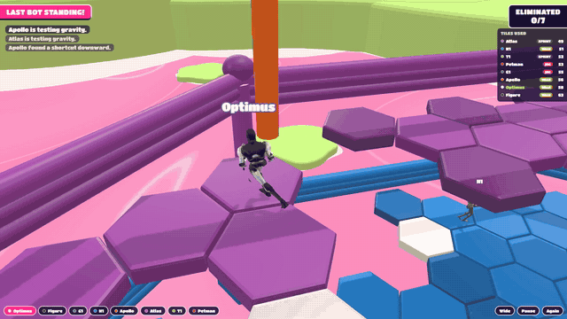
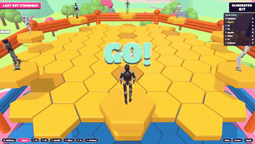
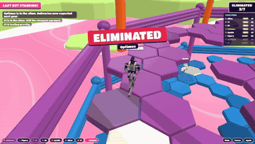
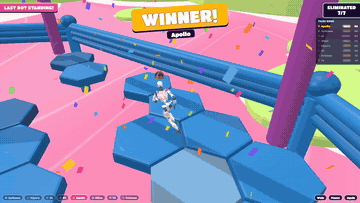
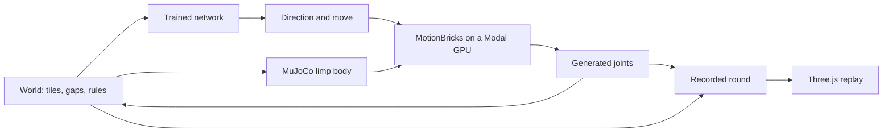
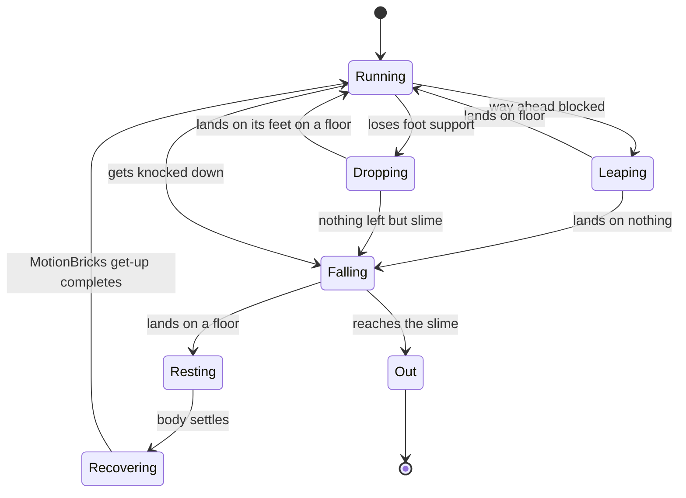
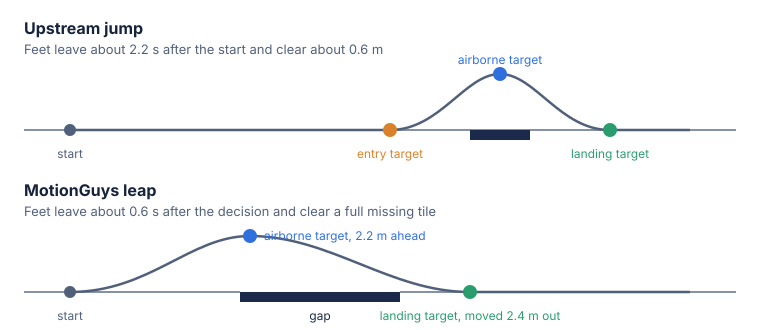

<h1 align="center">MotionGuys</h1>

<p align="center"><b>MotionBricks-powered humanoids in a Fall Guys-inspired survival arena.</b><br>
A trained policy chooses the route, the pace, and when to hop, NVIDIA MotionBricks generates the movement, and MuJoCo simulates knockdowns.</p>

<p align="center">
  
</p>

MotionGuys has grown from an obstacle race into **Hex-A-Bots**: eight simulated humanoids competing on six floors of disappearing hexagons above pink slime. It combines learned decisions, generated motion, physical falls, and a browser spectator view with robot tracking, a live tile counter, crowns, and confetti.

The browser plays recorded rounds; the robots make their decisions during the Python simulation. You can watch, pause, replay, and follow a robot locally without running a model.

| Mode | Arena | Recordings | Browser page |
|---|---|---:|---|
| **Hex-A-Bots** | Six floors of vanishing hexagons, robot meshes, trained policy, MuJoCo falls | 12 | `hex.html` |
| Spleef | Three floors of square tiles, gap-triggered leaps, original mannequins | 6 | `spleef.html` |
| Obstacle race | Fake doors, spinning sweepers, and fake tiles | 3 | `index.html` |

## Hex-A-Bots

Eight robots start on floating hexagons. Touch a tile and it whitens and vanishes. Fall through six floors into the slime and you are out. Last robot standing wins.

The lineup is Optimus, Figure, G1, H1, Apollo, Atlas, T1, and Petman. They share one trained policy, with different caution, thrift, and aggression inputs.

<table>
  <tr>
    <td></td>
    <td></td>
    <td></td>
  </tr>
  <tr>
    <td align="center">The rush</td>
    <td align="center">Eliminated</td>
    <td align="center">The crown</td>
  </tr>
</table>

| Measure, over the 12 rounds in `public/hex/` | Value |
|---|---:|
| Time to a winner, counting the 3 s countdown | 53.0 s to 67.8 s |
| Tiles touched | 6,148, 56% of each board |
| Falls | 550, 46 per round |
| Knockdowns by another robot | 2 |
| Hops attempted / landed on floor | 587 / 566 |
| Generated get-ups, only after a knockdown or the last plunge | 19 |
| Wins | H1 5, Apollo 4, Optimus 1, G1 1, T1 1, Figure 0, Atlas 0, Petman 0 |

Wins say nothing about real hardware. Every robot shares one skeleton and one network, and differs only in personality and mass. Motion is not retargeted to each body either.

### Is the trained brain better?

A separate local evaluation gave four randomly selected robots the network and four the hand-written policy in each of 24 recorded rounds. The network won **24 of 24 rounds**, against an even-match baseline of 12 wins.

| Local evaluation, seeds 101-124 | Network | Hand-written policy |
|---|---:|---:|
| Wins | 24 | 0 |
| Mean survival time | 56.5 s | 36.9 s |
| Tiles touched per second alive | 1.25 | 1.28 |
| Successful hops / attempts | 665 / 692 | 854 / 910 |

These evaluation recordings are local experiment outputs and are not bundled in the repository. The result shows progress in this experiment, rather than a general benchmark of MotionBricks or real robots. Recheck a new experiment with `scripts/check_brain.py`.

Training uses self-play in a fast simulation in `scripts/hex_brain.py`, with one shared network and a personality input per robot. The training loop is in `scripts/modal_brain.py`. The training world treats robots as dots, but its numbers are measured from real motion by `scripts/modal_turn.py` and the recorded rounds: a command takes about 0.3 s to show and a body turns at about 260 degrees per second, a foot with no tile under it is a fall, a leap travels 3.9 m to 6.8 m, and a landing runs on for about 4 m. Before that calibration a robot lasted 14 s on foot in training and 2.6 s in real rounds, so the network was practicing an easier game than the one it played.

### When robots hop

The public rounds use the `hopcold` brain, recorded with short hops of about one tile, a 1.4 s tile timer, and a smaller board. A hop is legal only when straight ahead and a sector to either side all break within 2 m, not counting the tile underfoot, and never in the first 10 s of play. A hop earns reward only if the robot is still on its feet 2 s after landing. A robot that drops through a hole keeps running and lands on its feet on the next floor. MuJoCo handles knockdowns and the last plunge into the slime.

| Real rounds, by brain | Round length, median | Falls per round | Tiles used | Hops per round | Hops landed |
|---|---:|---:|---:|---:|---:|
| First trained brain, never hops | 70 s | 80 | 41% | 0 | n/a |
| Long leaps, no calibrated landing rule | 74 s | 53 | 51% | 80 | 92% |
| `hopcold`, the public rounds | 61 s | 46 | 56% | 49 | 97% |

The second row's brain was rejected after watching it: robots jumped at the start of a round and then fell. A bug had counted the tile a robot stands on as blocking the path, so its numbers looked better than its play.

### Getting the mechanics right on tiny boards

The next stage is one robot alone on a few tiles, where the best possible score can be calculated. A tile lasts 1.4 s and a hop adds about 0.47 s in the air, so `scripts/ceiling.py` gives a ceiling of 18.2 s on 10 tiles and 35.1 s on 19. In real motion the median run lasts about 5 s on 10 tiles and 7 s on 19, with best runs of 15.5 s and 20.4 s. These networks can also hold still, by freezing in the last generated pose and turning on the spot, because a true stop would play evaluation-only clips. The numbers are not good enough to ship yet. They are in the code here but not in the public rounds, which were recorded by the commit before the tiny-board work.

The arena is rebuilt from real gameplay footage: tile shape, timing, floor colors, rails, and slime. [docs/HEXAGONS.md](docs/HEXAGONS.md) lists what was measured, what was inferred, and what changed on purpose. Robots are cut into one rigid part per bone by `scripts/build_robots.py` and stretched between recorded joints, with no rigging. Model authors and licenses are in [CREDITS.md](CREDITS.md).

Known limits:

- **Running is not physics.** A running robot follows MotionBricks exactly and only turns into a physical body once it is hit or falls, so it cannot stumble and catch itself.
- **Robots still fall a lot,** about 5.7 times per robot per round, down from 10, close to the five drops the floors require. 24% of landings end in a fall within 2 s, because a body runs on after touching down and cannot turn in time.
- **Almost half the arena goes unused.** Rounds end with about 56% of tiles touched.
- **Feet slide.** About 5.8 m/s at the 95th percentile. Slower gaits slide more on the model's own, measured at about 6.5 m/s below 3 m/s and about 0.5 m/s at a full run.
- **Limbs pass through their own body,** because a limp robot does not collide with itself.
- **Waiting robots shift their weight** in the browser, a drawn effect, because upstream idle clips cannot be recorded.
- **Some winners do not survive.** In 1 of the 12 rounds the winner was already falling and goes into the slime last.
- **Figure is not a real Figure.** No usable model exists, so it is a repainted Tesla Bot mesh.

### What to improve next

The movement is good enough for now. The weak part is still how robots read the map and how little they can adjust after a hop. Those numbers come from `scripts/check_falls.py` and `scripts/check_leaps.py`.

1. **Land better.** Train the network on where a landing really ends up, or generate a landing that absorbs more speed. Letting the current landing play longer did not help.
2. **Plan a route.** Each robot reacts every 0.3 s to what is around it. A short search through the untouched tiles, a few steps ahead, would stop robots from running into dead ends and give the network a target instead of a direction.
3. **Train on real motion.** Calibration closed most of the gap, but the dots still never catch a rim. Finishing training in the real rounds would close the rest.
4. **Stand still.** Waiting on a tile is the smartest move in the game and the robots cannot make it. It needs idle motion that is licensed for this use, or a trained balance policy.
5. **Physics while running.** A controller that tracks MotionBricks inside MuJoCo would let robots stumble, catch themselves, and shove each other properly.

## How it works

1. **Brain.** Every 0.3 s a network looks at the tiles around a robot, how long its own tile has left, the floor below, and its nearest rivals, then picks a direction, a gait, and whether to leap.
2. **Motion.** [MotionBricks](https://github.com/NVlabs/motionbricks) is a kinematic model trained on motion capture. Give it recent poses and target poses, and it generates the motion between them. It has no gravity, balance, or view of the course.
3. **World.** The Python simulation owns the floors and rules. Every frame it tests the generated joints against them.
4. **Physics.** Each robot also exists in one [MuJoCo](https://mujoco.org/) scene, with one capsule per bone and real tiles and rails. When a robot gets hit, or goes over the last edge into the slime, the copy from MotionBricks stops and gravity and contact take over, holding the pose it was in.
5. **Recovery.** Once a knocked-down body comes to rest its pose goes back to MotionBricks, which generates the get-up from whatever crumpled position it is shown. A plain drop through a hole needs no recovery, because the robot lands on its feet.
6. **Replay.** Joint positions and events are saved per round. The browser plays them back on the robot meshes, so a round looks the same on every machine and needs no GPU.

## System design

The game decides what a runner tries and judges what happened. MotionBricks only supplies how the body moves.



In Hex-A-Bots, generated movement hands over to physics when another body knocks a robot down or it goes over the last edge. Leaps are generated too, and a leap that comes down on nothing becomes a drop.



## Spleef, the first version

Every tile a foot touches falls 1.5 s later. A fall lands you on the floor below, and falling past the third floor puts you out. Last one standing wins.

The upstream jump runs up for about 2 s and clears about 0.6 m, which cannot cross a missing tile. The leap in `scripts/modal_leap.py` skips its entry target and moves its landing target farther out, and MotionBricks generates the rest. Runners only leap when there is a gap ahead and solid floor after it.

<p align="center">
  
</p>

The spectator camera follows a random runner up close for up to 6 s. If that runner falls, it stays about a second, then cuts to someone on the highest floor. The winner gets the last shot.

### Spleef results

Six recorded Spleef rounds, eight runners each, on a Modal A10. Three floors of 100 tiles, each tile 1.6 m wide.

| Measure | Value |
|---|---:|
| Round length | 15.4 s to 24.3 s |
| Tiles dropped | 614 |
| Leaps, all across a gap | 89 |
| Leaps landed on floor | 72 |
| Leaps that came down over a hole | 17 |
| Falls through a hole, not leaping | 46 |
| Falls off the edge | 35 |
| Get-ups back above 1.35 m | 51 |
| Median get-up | 0.97 s |
| Slowest get-up | 1.53 s |

One more runner had not got back up when the recording ended. Leap distance is not steered, so where hips touch down varies widely, from 1.3 m to 6.7 m between the 5th and 95th percentiles. That spread causes some of the misses. The leap is a big, tucked, cartoony shape, because the more natural setting only cleared about 1 m. Feet on the ground move about 0.5 m/s at the median but about 6 m/s at the 95th percentile, so expect visible sliding on turns. Runners also pass through each other, and different builds and headgear are drawn on one skeleton, not separate body models.

## The obstacle race

The first game, at the main page. Eight runners cross fake doors, two spinning sweepers, and fake tiles. Three recorded races, on a Modal L4.

<p align="center">
  
</p>

| Knockdown cause | Count |
|---|---:|
| Low sweeper, needs a jump | 45 |
| Solid door, a wrong guess | 38 |
| High sweeper, needs a duck | 13 |
| Fake tile | 12 |
| Course edge | 1 |

All 24 runners finished, from 42.7 s to 68.4 s, and all 93 get-ups completed with a median of 1.07 s. Jumps fail most because the upstream jump commits early while the sweeper keeps moving. Three races is a small sample, and these rates describe this setup and its simple runner policy, not MotionBricks in general.

## What we learned

- **Reusing a Smart Primitive drags the runner back.** `align_sequence_pivot` clamps to limits around a primitive's first placement, so every action needs a new instance.
- **Check long jumps frame by frame.** Several settings looked long on paper only because the hips moved at 9 to 10 m/s, close to a teleport.
- **A GPU wait looks like a hung job.** An L4 took minutes to start on the night of this build, while an A10 started in seconds. With the model plan and kernels cached, six rounds took about 40 s from launch to results.

## The video

The GIFs in Hex-A-Bots are cut from a real-time render of recorded round 7.

## Run it

### Watch a recorded round

Use Node.js 22.14 or newer. From the repository root:

```bash
npm ci
npm run dev
```

Open the printed local URL with **`/hex.html`** appended. It starts with round 7, the round shown in the GIFs. The root page (`/`) opens the original obstacle race.

| Hex-A-Bots control | What it does |
|---|---|
| Robot name button | Follow that robot; click it again to return to automatic shots |
| Wide | Toggle the wide arena view |
| Pause / Resume | Stop or continue playback |
| Again | Restart the recording |
| `?seed=1` through `?seed=12` | Choose a recorded round |
| `?seed=7&speed=0.5` | Watch round 7 at half speed |

For the earlier modes, open `/spleef.html?seed=4` (seeds 1-6) or `/index.html?seed=1` (seeds 1-3). In Spleef, drag to look around and double-click to return to the spectator camera.

Playback needs no API keys, model weights, or local inference GPU; it uses the recordings and processed robot models in `public/`.

### Check the browser build

```bash
npm test                # recording, hexagon events, replay, and camera checks
npm run build           # TypeScript check and production build of all three pages
npm run preview         # serve dist/ locally; append /hex.html
```

### Train and record new hexagon rounds

This optional path needs Python, a Modal account, and a trained policy on the shared `motionguys-cache` Modal volume. Python 3.12 matches the remote images. Install the local imports and authenticate:

```bash
python -m pip install modal modal-progress torch numpy mujoco==3.3.7
modal setup
```

Train first if the volume has no `brain/policy_hopcold.pt`, then record. Training uses an A10 and takes about 50 minutes; the recording image fetches the pinned upstream MotionBricks runtime and model assets and runs inference remotely.

```bash
modal run scripts/modal_brain.py --iterations 400 --tags hopcold
modal run scripts/modal_hex.py --seeds 1,2,3
python scripts/check_hex.py runs/hex
python scripts/check_leaps.py runs/hex
python scripts/check_leap_value.py runs/hex
```

Training also saves `runs/brain/policy_hopcold.pt` and `runs/brain/log_hopcold.jsonl` locally. Other tags in `scripts/modal_brain.py` train other reward settings, and `--policy` picks one when recording. `scripts/modal_turn.py` measures the real turning response the training sim copies. Recording writes paired `seed_N.json` metadata and `seed_N.bin` poses into `runs/hex/`. These outputs are ignored by Git. To watch a new round, copy both files into `public/hex/` and select its seed in the browser. Use a fresh seed number to keep the showcase recordings.

To compare the policy against the script, record fresh rounds with `--brains half`, then score the same seed range. For example:

```bash
modal run scripts/modal_hex.py --seeds 201,202,203 --brains half
python scripts/check_brain.py --first 201 --last 203
```

Three rounds are a smoke check; the evaluation above used 24. `python scripts/check_hex.py public/hex` reproduces the showcase summary, and `python scripts/check_falls.py` checks nearby untouched tiles at each showcase fall.

### Render video and rebuild robot meshes

The README GIFs come from recorded round 7. To render a video with event-based sound, install the renderer's local imports, build the replay, and render on Modal. Its remote image installs Chromium and FFmpeg.

```bash
python -m pip install playwright modal-progress
npm run build
modal run scripts/modal_render.py --seed 7 --out renders/hex-bots.mp4
```

To rebuild processed robot meshes, download the source models listed in [CREDITS.md](CREDITS.md), arrange them as expected by `scripts/build_robots.py`, and run:

```bash
python -m pip install trimesh pillow
python scripts/build_robots.py <models-dir>
```

The source models are separate downloads; the processed meshes are in `public/robots/`.

### Earlier simulations

```bash
modal run scripts/modal_spleef.py --seeds 1,2,3
modal run scripts/modal_spleef.py --seconds 20
modal run scripts/modal_leap.py
modal run scripts/modal_race.py::main --seeds 1,2,3
python scripts/check_race.py 1 2 3
```

Spleef recordings go into `runs/spleef/`, race recordings into `runs/races/`, and leap measurements into `runs/`. Cold image builds and TensorRT compilation add setup time before the first motion recording.

| Folder | What's in it |
|---|---|
| [`scripts/`](scripts/) | the hexagon, Spleef, and race simulations, the robot cutter, video rendering, and motion checks |
| [`src/game/`](src/game/) | decoding recordings, replaying events, and planning camera shots |
| [`src/hex.ts`](src/hex.ts), [`src/world.ts`](src/world.ts), [`src/robots.ts`](src/robots.ts) | the hexagon round, its surroundings, and the robots |
| [`src/spleef.ts`](src/spleef.ts), [`src/main.ts`](src/main.ts) | the older Three.js views |
| [`src/figure.ts`](src/figure.ts) | the original mannequin |
| [`public/`](public/) | robots, twelve hexagon rounds, six Spleef rounds, and three races |
| [`docs/`](docs/) | the build plan and motion integration notes |
| [`tests/`](tests/) | recording, event replay, and camera checks |
| [`media/`](media/) | the README GIFs and diagram |

## Credits

[MotionBricks](https://github.com/NVlabs/motionbricks) by NVIDIA generates the motion. Robot models, licenses, and the rest are in [CREDITS.md](CREDITS.md). This is an independent project, not affiliated with any company named here, and it uses no assets from Fall Guys.
