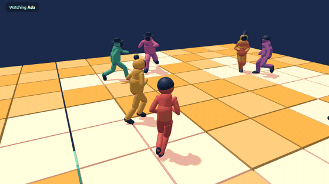
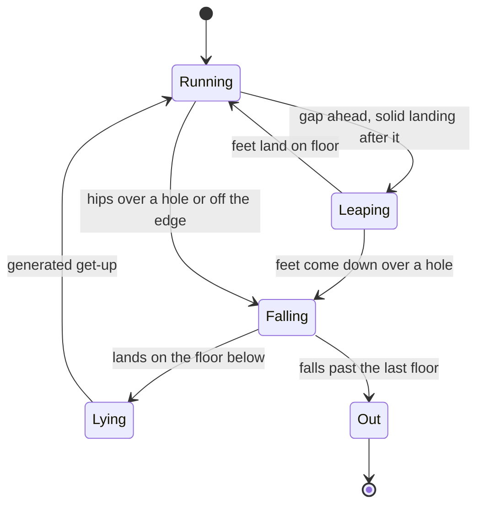

<h1 align="center">MotionGuys</h1>

<p align="center"><b>Eight MotionBricks runners on a floor that falls away under their feet.</b><br>
The model has no physics and never sees the world, so on its own it cannot fail. This project builds a world that makes it fail.</p>

<p align="center">
  
</p>

## How it works

1. **Motion.** [MotionBricks](https://github.com/NVlabs/motionbricks) is a kinematic model trained on motion capture. Give it recent poses and target poses, and it generates the motion between them. It has no gravity, balance, or view of the course.
2. **World.** The Python simulation owns the floors, obstacles, and rules. Every frame it tests the generated joints against them.
3. **Failure.** Feet coming down with the hips over a hole, a shin inside a sweeper, or a chest at a solid door all cause a fall. Nothing decides ahead of time who falls.
4. **Recovery.** The tumble itself is scripted, not physics. The runner then gets up with generated motion, because the model starts from whatever poses it is shown, including lying on the floor.
5. **Replay.** Joint positions and events are saved per round. The browser plays them back on an original mannequin, so a round looks the same on every machine and needs no GPU.

## System design

The game decides what a runner tries and judges what happened. MotionBricks only supplies how the body moves.


A runner moves between generated motion and the scripted tumble like this.



## Spleef

Every tile a foot touches falls 1.5 s later. A fall lands you on the floor below, and falling past the third floor puts you out. Last one standing wins.

The upstream jump runs up for about 2 s and clears about 0.6 m, which cannot cross a missing tile. The leap in `scripts/modal_leap.py` skips its entry target and moves its landing target farther out, and MotionBricks generates the rest. Runners only leap when there is a gap ahead and solid floor after it.

<p align="center">
  
</p>

The spectator camera follows a random runner up close for up to 6 s. If that runner falls, it stays about a second, then cuts to someone on the highest floor. The winner gets the last shot.

## Results

Six recorded Spleef rounds, eight runners each, on a Modal A10. Three floors of 100 tiles, each tile 1.6 m wide.

| Measure | Value |
|---|---:|
| Round length | 15.4 s to 24.3 s |
| Tiles dropped | 614 |
| Leaps, all across a gap | 89 |
| Leaps landed on floor | 72 |
| Leaps that came down over a hole | 17 |
| Falls through a hole, not leaping | 46 |
| Falls off the edge | 35 |
| Get-ups back above 1.35 m | 51 |
| Median get-up | 0.97 s |
| Slowest get-up | 1.53 s |

One more runner had not got back up when the recording ended. Leap distance is not steered, so where hips touch down varies widely, from 1.3 m to 6.7 m between the 5th and 95th percentiles. That spread causes some of the misses. The leap is a big, tucked, cartoony shape, because the more natural setting only cleared about 1 m. Feet on the ground move about 0.5 m/s at the median but about 6 m/s at the 95th percentile, so expect visible sliding on turns. Runners also pass through each other, and different builds and headgear are drawn on one skeleton, not separate body models.

## The obstacle race

The first game, at the main page. Eight runners cross fake doors, two spinning sweepers, and fake tiles. Three recorded races, on a Modal L4.

<p align="center">
  
</p>

| Knockdown cause | Count |
|---|---:|
| Low sweeper, needs a jump | 45 |
| Solid door, a wrong guess | 38 |
| High sweeper, needs a duck | 13 |
| Fake tile | 12 |
| Course edge | 1 |

All 24 runners finished, from 42.7 s to 68.4 s, and all 93 get-ups completed with a median of 1.07 s. Jumps fail most because the upstream jump commits early while the sweeper keeps moving. Three races is a small sample, and these rates describe this setup and its simple runner policy, not MotionBricks in general.

## What we learned

- **Reusing a Smart Primitive drags the runner back.** `align_sequence_pivot` clamps to limits around a primitive's first placement, so every action needs a new instance.
- **Check long jumps frame by frame.** Several settings looked long on paper only because the hips moved at 9 to 10 m/s, close to a teleport.
- **A GPU wait looks like a hung job.** An L4 took minutes to start on the night of this build, while an A10 started in seconds. With the model plan and kernels cached, six rounds took about 40 s from launch to results.

## The video

There is no finished video yet. The GIF at the top is a real recorded round, seed 4. The next version slows the runners down for a tense, close final between the last two.

## Run it

```bash
npm ci                  # Node.js 22.14 or newer
npm run dev             # open the printed local URL, then spleef.html
npm run check           # check TypeScript
npm test                # recording, event replay, and camera checks
npm run build           # check and build the browser replay
modal run scripts/modal_spleef.py --seeds 1,2,3       # record Spleef rounds, into runs/spleef/
modal run scripts/modal_spleef.py --seconds 20        # a quick look, no winner needed
modal run scripts/modal_leap.py                       # measure jump settings, into runs/
modal run scripts/modal_race.py::main --seeds 1,2,3   # record races, into runs/races/
python scripts/check_race.py 1 2 3                    # race progress and failures by runner
```

Append `?seed=1` through `?seed=6` on `spleef.html`, or `?seed=1` through `?seed=3` on the race, to pick a recording. Drag to look around. On `spleef.html`, double click to go back to spectating.

The replay needs no API keys or GPU. Recording needs a Modal account. A cold first run builds an image in about 4 minutes and a TensorRT plan in about 2.

| Folder | What's in it |
|---|---|
| [`scripts/`](scripts/) | the Spleef and race simulations, jump measurements, and motion checks |
| [`src/game/`](src/game/) | decoding recordings, replaying events, and planning camera shots |
| [`src/spleef.ts`](src/spleef.ts), [`src/main.ts`](src/main.ts) | the two Three.js views |
| [`src/figure.ts`](src/figure.ts) | the original mannequin |
| [`public/`](public/) | six recorded Spleef rounds and three recorded races |
| [`docs/`](docs/) | the build plan and motion integration notes |
| [`tests/`](tests/) | recording, event replay, and camera checks |
| [`media/`](media/) | the README GIFs and diagram |

## Credits

[MotionBricks](https://github.com/NVlabs/motionbricks) by NVIDIA generates the motion, under the NVIDIA Open Model Agreement. [Modal](https://modal.com/) runs it. [Three.js](https://threejs.org/) draws the replay. The door, sweeper, and collapsing floor ideas are inspired by party game obstacle rounds such as Fall Guys and by Spleef. This is an independent project, built from original geometry and characters, and it uses no assets from those games.
