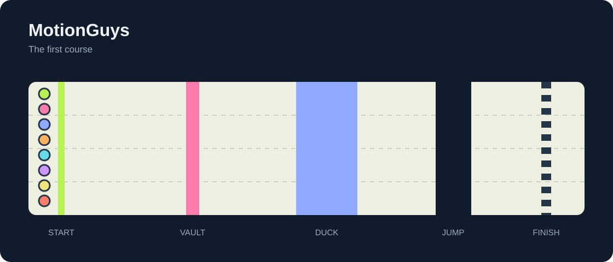
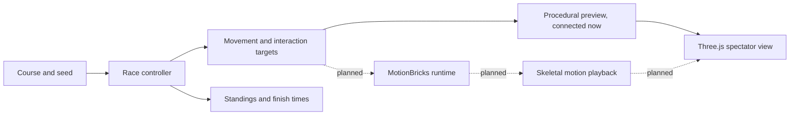

<h1 align="center">MotionGuys</h1>

<p align="center"><b>MotionBricks characters race through an obstacle course.</b><br>
Eight runners, a wall to vault, a ceiling to duck under, and a gap before the finish. You watch the race.</p>

<p align="center">
  
</p>

This is the project skeleton. The browser preview runs with procedural characters. MotionBricks inference, skeletal playback, and obstacle physics are not connected yet.

## How it works

1. **Course.** One shared track with a low wall, a low ceiling, and a gap. The layout lives in `src/game/course.ts`.
2. **Runners.** Eight named characters race automatically. A seed fixes their speeds. The current controller follows straight lanes and selects an action for each obstacle.
3. **Motion.** The intended MotionBricks integration receives movement and interaction targets and generates skeletal motion. The provider contract is in place; the current preview uses simple procedural poses instead.
4. **Race.** A fixed-step simulation tracks progress, finish times, and standings. The browser draws the scene separately so the same seed produces the same race order.

## System design

The race chooses where each runner goes. The motion layer supplies how its body moves.



## Results

| Component | Status |
|---|---|
| Eight runners and seeded race order | Implemented |
| Course and procedural action preview | Implemented |
| Pause, restart, orbit camera, standings | Implemented |
| MotionBricks inference and skeleton playback | Next |
| Contact checks, falls, recovery, and runner collisions | Planned |
| Saved runs and video export | Planned |

There are no MotionBricks performance results yet. In this preview, characters follow scripted lanes and clear every obstacle. Their seeded speeds determine the winner. This does not test whether generated motion can navigate the course successfully.

## The video

The intended video follows a pack of MotionBricks characters through the same course, cutting between the leader and the runners trying to catch up. There is no finished video yet. Replace the course diagram with a real race GIF once the motion integration works.

## Run it

```bash
npm ci                  # Node.js 22.14 or newer
npm run dev             # open the printed local URL
npm run check           # check TypeScript
npm test                # seeded race and finish checks
npm run build           # check and build the browser preview
```

Append `?seed=123` to replay a different seeded race. Drag to orbit the camera and scroll to zoom. Pause freezes the race, and Restart repeats the current seed.

The skeleton runs locally without API keys or GPU inference. MotionBricks GPU latency and cost have not been measured for this project.

| Folder | What's in it |
|---|---|
| [`src/game/`](src/game/) | the course, runner state, seeded race, and standings |
| [`src/motion/`](src/motion/) | the motion contract and an unconnected MotionBricks provider |
| [`src/main.ts`](src/main.ts) | the Three.js course, procedural characters, and spectator controls |
| [`docs/`](docs/) | the build plan and motion integration notes |
| [`tests/`](tests/) | reproducibility, course actions, and finish checks |
| [`media/`](media/) | the README course diagram, later the real race GIF |

## Credits

[MotionBricks](https://github.com/NVlabs/motionbricks) by NVIDIA supplies the intended motion model. [Three.js](https://threejs.org/) renders the preview. Inspired by the obstacle races in Fall Guys. This is an independent project and uses no Fall Guys assets.
