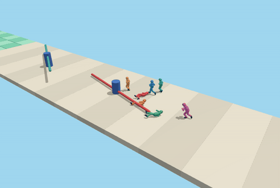
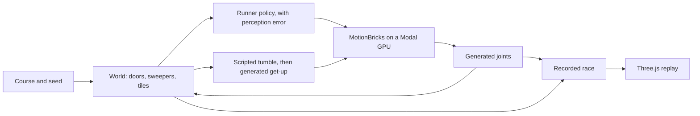

<h1 align="center">MotionGuys</h1>

<p align="center"><b>MotionBricks characters race through fake doors, sweepers, and shaky tiles.</b><br>
Eight runners, recorded on a GPU and replayed in your browser. They trip because their generated legs actually hit things.</p>

<p align="center">
  
</p>

## How it works

1. **Motion.** [MotionBricks](https://github.com/NVlabs/motionbricks) is a kinematic model trained on motion capture. It fills in motion between recent poses and target poses. It has no gravity, balance, or view of the course, so on its own it cannot fail.
2. **World.** `scripts/modal_race.py` owns the course: fake doors, spinning sweepers, and tiles that drop. Every frame it tests the generated joints against that course.
3. **Failure.** A joint inside a sweeper, a chest at a solid door, or hips over a hole knocks the runner down. Nothing decides ahead of time who gets hit.
4. **Recovery.** The fall itself is a scripted tumble, not physics. The runner then gets up with generated motion, because the model starts from whatever poses it was shown, including lying on the floor.
5. **Replay.** Joint positions and events are saved per race. The browser plays them back on an original mannequin, so a race looks the same on every machine and needs no GPU.

## System design

The race chooses what a runner tries and judges what happened. MotionBricks only supplies how the body moves.



## Results

Three recorded races, eight runners each, SOMA model on a Modal L4.

| Measure | Value |
|---|---:|
| Runners who finished | 24 of 24 |
| Finish times | 42.7 s to 68.4 s |
| Knockdowns | 109 |
| Get-ups back above 1.35 m | 93 of 93 |
| Median get-up | 1.07 s |
| Slowest get-up | 1.40 s |

| Knockdown cause | Count |
|---|---:|
| Low sweeper, needs a jump | 45 |
| Solid door, a wrong guess | 38 |
| High sweeper, needs a duck | 13 |
| Fake tile | 12 |
| Course edge | 1 |

Jumps fail most because they commit early. A jump only clears the low sweeper from about 2.2 s to 2.5 s after it starts, and the sweeper keeps moving during that wait. Shins and feet took most of those hits.

| Jump | Widest hole it clears, 5 tries |
|---|---:|
| `jump_0_5m` | 0.35 m to 0.63 m |
| `jump_0_75m` | 0.59 m to 0.69 m |

Time per frame with runners sharing one engine, from an earlier 10 s run. A 30 Hz frame allows 33.3 ms.

| Runners | Mean | p95 | Max |
|---:|---:|---:|---:|
| 1 | 1.2 ms | 7.6 ms | 9.5 ms |
| 2 | 2.3 ms | 8.2 ms | 15.5 ms |
| 8 | 9.2 ms | 26.1 ms | 62.1 ms |

Contact uses joint positions, not a body mesh, and runners pass through each other. The tumble is scripted, so it says nothing about how a real person falls. Runner decisions come from a simple policy with added error, so these failure rates describe this setup and not MotionBricks in general. Get-ups are measured by head height. Three races is a small sample.

## The video

There is no finished video yet. The GIF above is a real recorded race from seed 2. The intended video follows the pack and cuts to the falls.

## Run it

```bash
npm ci                  # Node.js 22.14 or newer
npm run dev             # open the printed local URL
npm run check           # check TypeScript
npm test                # recording and event replay checks
npm run build           # check and build the browser replay
modal run scripts/modal_race.py::main --seeds 1,2,3   # record races, into runs/races/
modal run scripts/modal_race.py::jumps                # measure jump distance
python scripts/check_race.py 1 2 3                    # progress and failures by runner
```

Append `?seed=1`, `?seed=2`, or `?seed=3` to pick a race. Drag to look around and double click to follow the pack again.

The replay needs no API keys or GPU. Recording needs a Modal account. A cold first run builds an image in about 4 minutes and a TensorRT plan in about 2.

| Folder | What's in it |
|---|---|
| [`scripts/`](scripts/) | the race simulation, jump measurements, and motion checks |
| [`src/game/`](src/game/) | decoding a recording and replaying its events |
| [`src/main.ts`](src/main.ts) | the Three.js course, mannequins, and spectator controls |
| [`public/races/`](public/races/) | three recorded races |
| [`docs/`](docs/) | the build plan and motion integration notes |
| [`tests/`](tests/) | recording and event replay checks |
| [`media/`](media/) | the README GIFs and an early course diagram |

## Credits

[MotionBricks](https://github.com/NVlabs/motionbricks) by NVIDIA generates the motion, under the NVIDIA Open Model Agreement. [Modal](https://modal.com/) runs it. [Three.js](https://threejs.org/) draws the replay. The door, sweeper, and tile ideas are inspired by the obstacle rounds in Fall Guys. This is an independent project, built from original geometry and characters, and it uses no Fall Guys assets.
